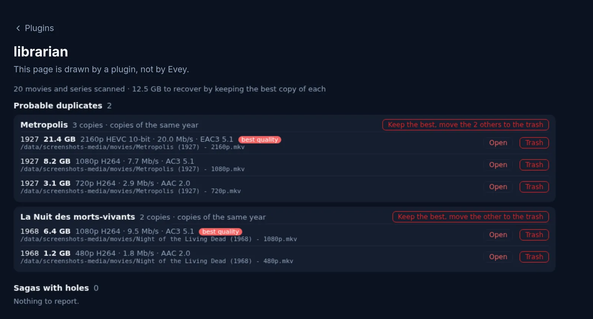
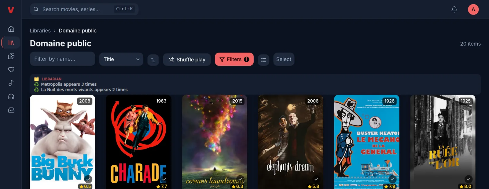
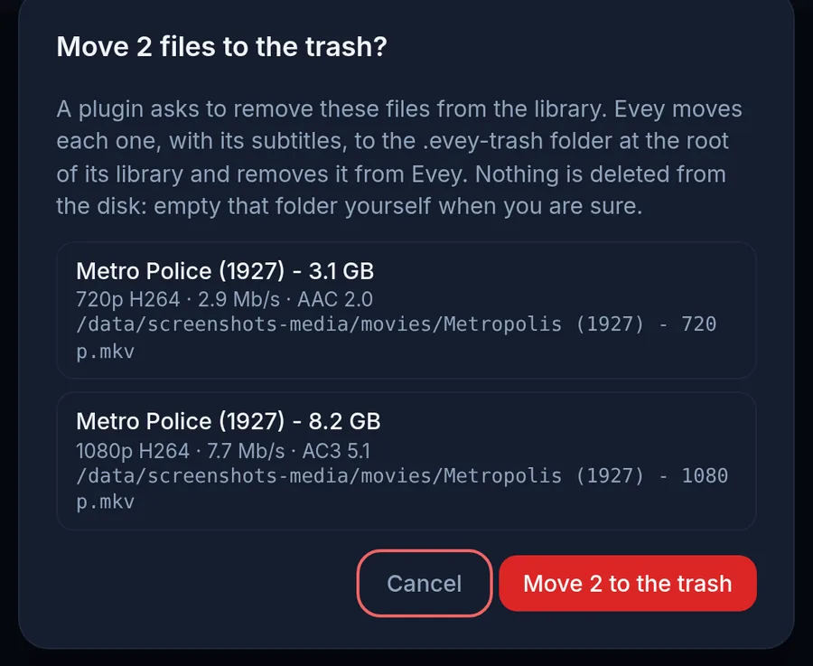

# 🗂️ Librarian

**Tidy up your Evey library: find the films you have twice, keep the best copy, and spot the sagas with a missing episode.**



## What it does

- ♻️ **Finds duplicates.** The same film twice (or more) in your libraries, with each copy's quality side by side: resolution, codec, bitrate, audio, size.
- 🏆 **Marks the best copy.** Higher resolution first, then HDR, colour depth and bitrate. A remake from another year is never mistaken for a spare.
- 🗑️ **Clears the spares, safely.** One click on *Keep the best, move the others to the trash*, or *Trash* on a single copy. Evey asks first, and nothing is ever deleted from your disk (see below).
- 🧩 **Spots holes in sagas.** You keep *Rocky II* and *III* but *Rocky* is missing? It tells you.
- 📚 **Shows up where you browse.** Each library page gets a small strip with its own findings. A clean library shows nothing.



## Install

1. In Evey, open **Admin > Plugins** and click **Install Plugin**.
2. Choose **From URL** and paste `https://github.com/eveyproject/evey-plugin-librarian`.
3. The preview says it is **Signed by Evey project**. Click **Install**.

The page then appears in the admin menu, under **Plugins > Librarian**.

> Needs Evey **0.1.14** or later.

## Using it

Open **Admin > Plugins > Librarian**. The top line tells you how many films were checked and how much space you would get back by keeping only the best copy of each.

For each duplicate:

| Button | What happens |
|---|---|
| **Open** | Goes to that copy's page in Evey. |
| **Trash** | Moves that one copy to the trash. |
| **Keep the best, move the others to the trash** | Keeps the copy marked *best quality* and moves the others. |

Before anything moves, **Evey itself** shows what is about to go, from its own records: title, size, quality and file. You confirm or cancel there.



After the move, a green box at the top of the page says which copy you kept (with a link to it), where the others went, and offers **Undo**.

### Where do the files go?

Into a folder named **`.evey-trash`** at the root of the library, with the same sub-folders. **Nothing is deleted from your disk.** Empty that folder yourself when you are sure, from your file manager or your NAS.

To get a file back: click **Undo** right after, or move it back where it was and scan the library again.

## What it can see and do

| | |
|---|---|
| ✅ Reads | titles, years, file paths, sizes and video/audio quality of your films and series |
| ✅ Asks | Evey to move a file to the trash, which you always confirm in Evey's own window |
| ❌ Never | deletes a file, connects to the internet, or stores anything |

File paths and quality are shown to **administrators only**. Anyone else browsing a library sees the strip with titles only.

## Questions

**It says "path not available".** You are not signed in as an administrator, or the plugin was installed without its `media.files` permission. Reinstall it and accept the permissions.

**Trash is not offered on my phone or TV.** It works from the admin page in a web browser for now.

**A remake shows up as a duplicate.** Two films with the same title but different years are listed as *remake or another edition?* and never offered to the trash together.

**Does it work with series?** Duplicate series are listed (a series is a folder, so there is nothing to trash); saga holes are checked on films.

<details>
<summary><b>For developers</b></summary>

### Permissions

- `public`: titles, years and types through the host bridge.
- `media.files`: file path, size and quality of each item. Evey puts it on the plugin token only when the viewer is an administrator.
- `media.trash`: the admin page may call `evey.media.trash(ids)` and `evey.media.restore(paths)`. The host shows its own confirmation and calls the admin endpoints on the administrator's session; the plugin never holds that right itself.
- Slots: `admin.nav` (the full page) and `library.sidebar` (the strip).

### Design

- The backend (`main.js`) is the minimal gRPC lifecycle stub; all behaviour lives in the front modules.
- The front modules are dependency-free scripts written directly in `dist/`. The detection logic's source of truth is `dist/scan.js`, which also reads the libraries page by page (500 items a page, movies then series); both modules inline it (the sandbox loads one self-contained script) and `tests/scan.test.mjs` fails if a copy drifts.

### Build and release

```sh
npm test                    # detection logic and drift guard
./scripts/build-zip.sh      # -> out/librarian-<version>.zip
```

The same commit always gives the same zip, so a rebuild can be compared with a published release byte for byte. To release, bump `version` in `plugin.yaml` and push a tag `v<version>`: the workflow builds, signs with the project key and publishes `librarian-<version>.zip`, its cosign signature and its sha256.

The Evey project key has the fingerprint `sha256:c29eb603b19d99a50f3fa6c94b7e92c41710779261e73e0fa31d53a78902e09a`. Compare it with the one the install preview shows before you trust it.

</details>

## License

MIT, see [LICENSE](LICENSE).
